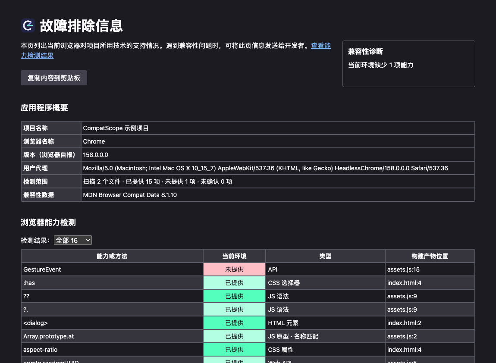

<h1 align="center"> CompatScope</h1>
<p align="center"><strong>Turn a frontend build into a compatibility report that runs in the browser you're troubleshooting.</strong></p>
<p align="center"><a href="./README.md" lang="zh-CN">简体中文</a> · <strong>English</strong> · <a href="https://github.com/Erlin0220/compat-scope/releases/latest">Latest release</a></p>

A feature works on your machine but not in a user's browser. CompatScope scans the JavaScript, CSS, and HTML you ship and produces a standalone `compat.html`. Ask the user to open it: the report shows **which features their browser exposes, where each was found in your build, and when other browsers added native support**.

**[Download the sample report](https://github.com/Erlin0220/compat-scope/releases/download/v0.1.0/compat-example.html)** and open it in your browser. No installation needed. The v0.1.0 report UI is in Chinese; the status labels are translated [below](#reading-a-report). Or [generate a report for your build](#generate-a-report).



In this [sample build](https://github.com/Erlin0220/compat-scope/blob/v0.1.0/examples/build/assets.js#L14-L16), Chrome doesn't expose `GestureEvent`. Line 15 checks for it before using it. **A red row means a capability is missing in this context, not that the line throws.**

## Generate a report

Build your frontend as usual, then run this command from your project root. Use Node.js 22.x (22.13 or later) or Node.js 24+. The command runs the v0.1.0 package from GitHub Releases without adding it to your project dependencies.

```sh
npx --yes https://github.com/Erlin0220/compat-scope/releases/download/v0.1.0/compat-scope-0.1.0.tgz ./dist
```

**Open `dist/compat.html`.** Send the file directly, or deploy it with the same build and share the URL. Prefer the deployed copy when investigating APIs that depend on the page environment. The report works offline, doesn't load your application code, and doesn't send diagnostics to a server.

### Run it after every build

Add the CLI as a dev dependency with the package manager your project already uses:

```sh
# npm
npm install -D https://github.com/Erlin0220/compat-scope/releases/download/v0.1.0/compat-scope-0.1.0.tgz

# pnpm: run inside the frontend application package
pnpm add -D https://github.com/Erlin0220/compat-scope/releases/download/v0.1.0/compat-scope-0.1.0.tgz
```

Add `"compat": "compat-scope ./dist --name Portal"` to the `scripts` section of your `package.json`. After your build finishes, run `npm run compat` or `pnpm run compat`. In a pnpm workspace, use pnpm for installation as well.

### CLI reference

| Argument | Purpose | Default |
| --- | --- | --- |
| `[directory]` | Frontend build directory to scan | `./dist` |
| `--name <name>` | Project label shown in the report; include a release ID if useful | Build directory name |
| `--out <path>` | Output HTML path, relative to the working directory unless absolute | `compat.html` inside the build directory |
| `-h, --help` | Print usage | — |

## Reading a report

Check the project label and browser, then filter for **未提供** (not available). Every finding includes a **file and line number in the build**. The version table comes from [MDN Browser Compat Data](https://github.com/mdn/browser-compat-data); it describes browser releases, while the probe describes the page you opened. The copy button copies the full diagnostic text regardless of the active filter.

| Report status | What it tells you |
| --- | --- |
| **已提供 · Available** | This page passed the probe. For example, the report found the `navigator.clipboard.writeText` method; it didn't try to write to the clipboard. |
| **未提供 · Not available** | This page didn't expose the capability, or the browser didn't accept the syntax. Check the listed call site to see whether the feature is required or optional. |
| **未确认 · Unconfirmed** | A reliable probe wasn't available or couldn't run under the page's restrictions. Treat the result as unknown, not unsupported. |

**Troubleshooting an iframe?** Scan the host build and the embedded build separately. Open each report in its corresponding context. The host report doesn't crawl iframe sources, and a passing check in the top-level page doesn't establish availability or permissions inside the frame.

## What gets scanned

- **JavaScript:** Recognized Web APIs, built-ins, and syntax such as `AbortSignal.any()`, `Object.hasOwn()`, and `?.`. Prototype methods are matched by name: an application's own `.at()` can match a built-in, so check the listed location.
- **CSS and HTML:** Selected selectors, properties, rules, elements, and attributes, including `:has()`, `aspect-ratio`, `<dialog>`, and `popover`. Inline scripts and styles in HTML are also scanned.
- **Scope:** Findings describe the supplied build. CompatScope doesn't execute the bundle, follow runtime downloads, resolve every alias, or infer the effect of polyfills and fallbacks. The reference table covers ten desktop, mobile, and WebView entries; it doesn't assign a minimum browser version to the entire app.

## Run from source

```sh
git clone https://github.com/Erlin0220/compat-scope.git
cd compat-scope
npm ci
node cli.js examples/build --name "CompatScope Demo"
npm test
```

Open `examples/build/compat.html` to see the result. To [report a missed feature or false positive](https://github.com/Erlin0220/compat-scope/issues), include a minimal build snippet, the observed result, and what you expected. Prototype-method matching is adapted from [compat-audit](https://github.com/Goodzilla/compat-audit); see [NOTICE](./NOTICE).
